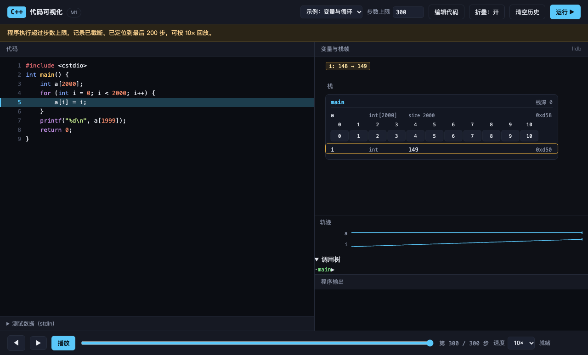

# c可视 — C/C++ 代码可视化

把 C++ 代码**一行一行执行**给学生看，同时把**栈帧、变量、数组/容器、指针、链表/树、递归结构**画出来。

面向竞赛/算法初学者：写得出代码，但不知道代码到底做了什么。


## 功能

- 逐行回放 + 单步（`←` / `→`）+ 0.25×–10× 速度
- 栈帧卡片：变量名 / 类型 / 值 / 地址；深栈可缩放（100%–200%）
- `vector` / `map` / `set` / `queue` / `stack` / `pair` 语义化展示
- 指针箭头、**`new` 出来的链表/树节点**（堆区平面视图，最多 64 个节点）
- 递归调用树、栈深、压栈/返回过渡动画
- 循环折叠、变化摘要（diff）
- 输入数据（支持多组数据切换）+ **期望输出对比**（✓ / ✗ 第 N 行）
- TLE 截断回放（最后 200 步，10×）、崩溃行标红、深递归/栈溢出提示
- 历史运行列表（点击回放）、代码自动保存、导出 trace

| | |
|---|---|
|  |  |

## 下载安装

- **macOS**：下载 `c-visual-1.0.0.dmg`，打开后把 `c可视` 拖进「应用程序」。
  第一次打开若被 Gatekeeper 拦住：右键 → 打开。
- **Windows**：下载 `c-visual-windows.zip`，解压后运行 `c-visual\c-visual.exe`。
  **Windows 版尚未在真机验证**（依赖 LLDB 的 Python 脚本接口），遇到问题请开 issue。

## 环境要求

程序会被**本机编译器**编译、用**本机调试器**追踪，所以需要：

| 平台 | 需要 |
|---|---|
| macOS | 系统自带 `clang++` 和 `lldb`（装 Xcode Command Line Tools 即可：`xcode-select --install`） |
| Windows | 安装 [LLVM](https://github.com/llvm/llvm-project/releases)（含 `clang++.exe`、`lldb.exe`），并把 `bin` 加进 PATH |

macOS 上被调试的二进制不能放在 `~/Documents`、`~/Desktop`、`~/Downloads`
（TCC 会让 debugserver 静默挂起）；程序会把它们放到 `~/.cppviz/runs/`，不受影响。

## 使用

启动后浏览器会打开 `http://127.0.0.1:<随机端口>/`：

1. 选一个示例（或直接粘贴代码）
2. 「输入数据」里填 stdin（「读入求和」示例已自带）
3. 点「运行 ▶」，用 `上一步 / 下一步` 或拖动进度条回放
4. 想看输出对不对：把标准答案贴进「期望输出」，运行后标题右侧会显示 `✓ 输出一致`

历史运行在左栏「历史运行」里，点一下即可回放；工具条「导出」可下载当前 `trace.jsonl`。

## 从源码运行

```bash
cd cppviz
./run.sh      # 构建 + 启动 + 打开浏览器
./smoke.sh    # 全链路验收（必须 PASS）
```

需要 JDK 21（`/opt/homebrew/opt/openjdk@21` 或设置 `JAVA_HOME`），无 Maven/Gradle。

## 打包

```bash
./package.sh                    # macOS：dist/out/c可视.app + c-visual-1.0.0.dmg
```
Windows 在仓库根目录用 PowerShell：`./package.ps1`（产出 `dist/out` 下的 zip）。
推 `v*` tag 时 GitHub Actions 会自动构建两个平台的包并挂到 Release。

## 已知限制

- stdout 由 C 运行时缓冲：小程序的输出可能到结束才一次性出现（大输出会分块显示）
- 整段代码写在一行时，行断点只触发一次
- 单文件程序；不支持多文件工程
- 堆对象靠指针遍历发现，最多 64 个节点；更深的结构只显示前 64 个

## 致谢 / 许可

题库风格参考洛谷（Luogu）等竞赛平台；本项目与这些平台无关。

代码以 **MIT** 协议开源，见 [LICENSE](LICENSE)。
