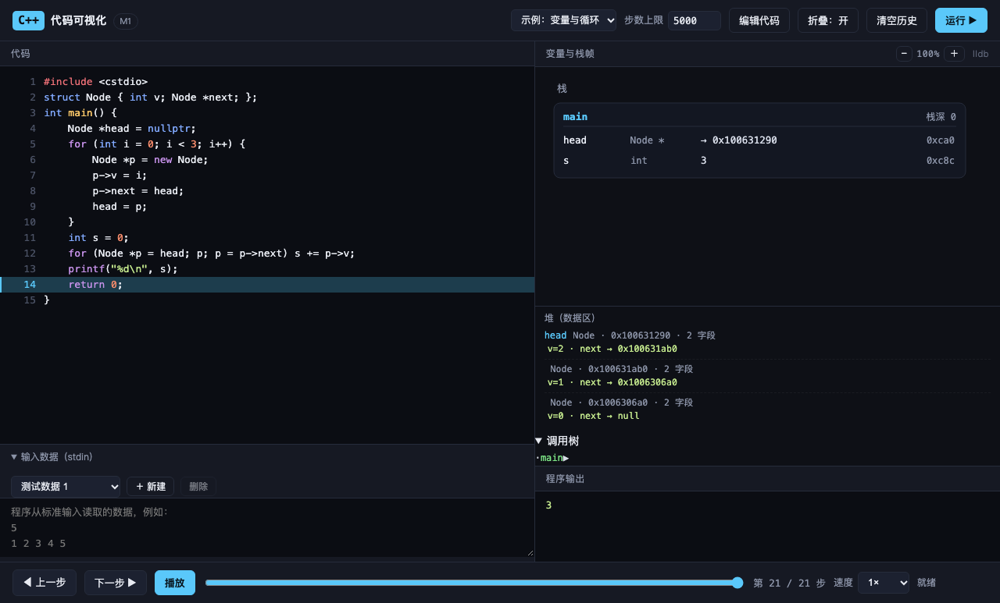
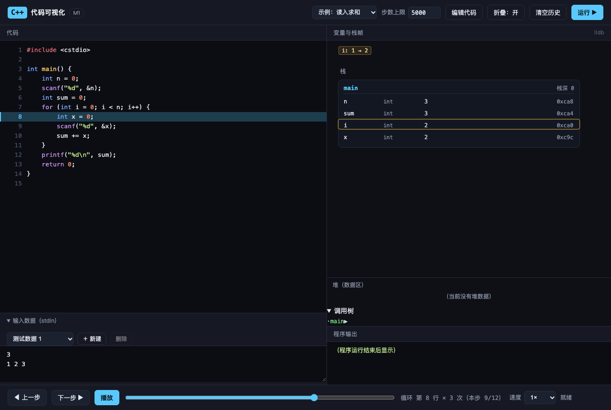

# c可视 — C/C++ 代码可视化

把 C++ 代码**一行一行执行**给学生看，同时把**栈帧、变量、数组/容器、指针、链表/树、递归结构**画出来。

面向竞赛/算法初学者：写得出代码，但不知道代码到底做了什么。



📖 **[完整使用手册](docs/manual.md)** —— 界面说明、功能详解、快捷键、常见问题。

## 功能

- 逐行回放 + 单步（`←` / `→`）+ 0.25×–10× 速度
- 栈帧卡片：变量名 / 类型 / 值 / 地址；深栈可缩放（100%–200%）
- `vector` / `map` / `set` / `queue` / `stack` / `pair` 语义化展示
- 指针箭头、**`new` 出来的链表/树节点**（堆区平面视图，最多 64 个节点）
- 递归调用树、栈深、压栈/返回过渡动画
- 循环折叠、变化摘要（diff）
- 输入数据（支持多组数据切换）+ **期望输出对比**（✓ / ✗ 第 N 行）
- TLE 截断回放（最后 200 步，10×）、崩溃行标红、深递归/栈溢出提示
- 历史运行列表（点击回放）、代码自动保存、导出 trace

| | |
|---|---|
|  |  |

## 下载安装

安装包在 **[Releases](https://github.com/yuehanGuan/c-visual/releases/latest)**。

### macOS

1. 下载 `c-visual-<版本>.dmg`，打开后把 **c可视** 拖进「应用程序」
2. **第一次打开会被 Gatekeeper 拦住**，提示「Apple 无法验证 c可视」——因为安装包没有 Apple 开发者签名，不是程序有问题。点「完成」后二选一：
   - **图形界面**：系统设置 → 隐私与安全性 → 滚到「安全性」→ 点「仍要打开」→ 输入密码/Touch ID → 再点「打开」
   - **终端**：`xattr -dr com.apple.quarantine "/Applications/c可视.app"`
3. 之后再双击就能直接打开

> 逐步说明、卸载方法、常见报错见 **[安装指南](docs/install.md)**。

### Windows

1. 安装 [LLVM](https://github.com/llvm/llvm-project/releases)（要 `clang++.exe` 和 `lldb.exe`），把它的 `bin` 目录加进 PATH
2. 下载 `c-visual-windows.zip`，解压到任意目录
3. 双击 `c-visual\c-visual.exe`；若 SmartScreen 拦截，点「更多信息 → 仍要运行」
4. 已在 Windows 11 + LLVM 23.1.6 真机验证（编译 / 逐行追踪 / STL 容器 / 崩溃定位全部通过）

## 环境要求

程序会被**本机编译器**编译、用**本机调试器**追踪，所以需要：

| 平台 | 需要 |
|---|---|
| macOS | 系统自带 `clang++` 和 `lldb`（装 Xcode Command Line Tools 即可：`xcode-select --install`） |
| Windows | 装 [LLVM](https://github.com/llvm/llvm-project/releases)（含 `clang++.exe`、`lldb.exe`）+ **Python 3.10 x64**（官方 Windows 版 lldb 要加载 `python310.dll`） |

启动时 c可视 会**自动检测** `clang++` / `lldb` / lldb 的 Python 支持；缺少时界面顶部会出现「**帮我安装**」按钮：
macOS 直接调起 Xcode 命令行工具安装，Windows 打开 LLVM 下载页，装好后自动检测并消失。

Windows 上不用手动配 PATH：c可视 会自动在 `C:\Program Files\LLVM\bin`、`%LOCALAPPDATA%\Programs\LLVM\bin`
等常见位置找 `clang++` / `lldb`，也会自动把 `python310.dll` 所在目录补进调试器环境；
想指定自己的工具链就设 `CPVIZ_COMPILER` / `CPVIZ_LLDB`（绝对路径）。

macOS 上被调试的二进制不能放在 `~/Documents`、`~/Desktop`、`~/Downloads`
（TCC 会让 debugserver 静默挂起）；程序会把它们放到 `~/.cppviz/runs/`，不受影响。

## 快速上手

启动后浏览器会打开 `http://127.0.0.1:<随机端口>/`：

1. 选「示例：读入求和」（自带输入和期望输出）
2. 点「运行 ▶」
3. 按「下一步」或键盘 `→` 单步，看左边高亮行、右边变量变化
4. 「程序输出」右侧显示 `✓ 输出一致` 就说明结果正确
5. 左栏「历史运行」可随时回放刚才这次

更细的界面说明、颜色含义、快捷键和 FAQ 见 **[使用手册](docs/manual.md)**。

## 从源码运行

```bash
cd cppviz
./run.sh      # 构建 + 启动 + 打开浏览器
./smoke.sh    # 全链路验收（必须 PASS）
```

需要 JDK 21（`/opt/homebrew/opt/openjdk@21` 或设置 `JAVA_HOME`），无 Maven/Gradle。

## 打包

```bash
./package.sh                    # macOS：dist/out/c可视.app + c-visual-1.0.0.dmg
```
Windows 在仓库根目录用 PowerShell：`./package.ps1`（产出 `dist/out` 下的 zip）。
推 `v*` tag 时 GitHub Actions 会自动构建两个平台的包并挂到 Release。

## 已知限制

- stdout 由 C 运行时缓冲：小程序的输出可能到结束才一次性出现（大输出会分块显示）
- 整段代码写在一行时，行断点只触发一次
- 单文件程序；不支持多文件工程
- 堆对象靠指针遍历发现，最多 64 个节点；更深的结构只显示前 64 个

## 反馈问题

- **软件内**：工具条 **「反馈」** 会自动填入版本、系统、当前代码、输入和错误信息，可一键复制或发邮件
- **邮件**：**13076662816@163.com**
- **GitHub**：[提交 Issue](https://github.com/yuehanGuan/c-visual/issues/new?template=bug_report.yml)

## 致谢 / 许可

题库风格参考洛谷（Luogu）等竞赛平台；本项目与这些平台无关。

代码以 **MIT** 协议开源，见 [LICENSE](LICENSE)。
