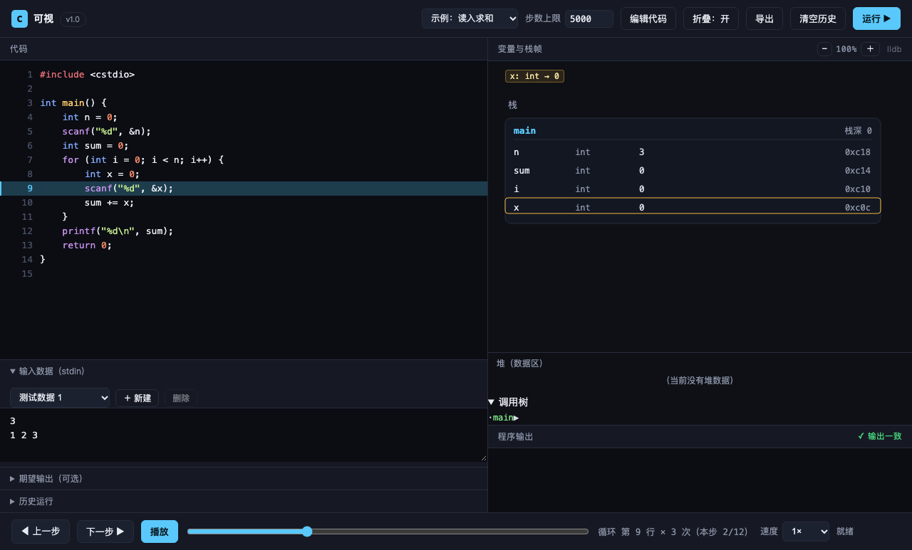

# c可视 使用手册

把 C/C++ 代码**一行一行执行**给学生看，同时画出**栈帧、变量、数组/容器、指针、链表/树、递归结构**。



---

## 1. 安装与启动

### macOS

1. 从 [Releases](https://github.com/yuehanGuan/c-visual/releases) 下载 `c-visual-1.0.0.dmg`
2. 打开 dmg，把 **c可视** 拖进「应用程序」
3. 首次打开若提示"无法验证开发者"：在「应用程序」里**右键 → 打开**

### Windows

1. 下载 `c-visual-windows.zip`，解压到任意目录
2. 先安装 [LLVM](https://github.com/llvm/llvm-project/releases)（要 `clang++.exe` 和 `lldb.exe`），把它的 `bin` 目录加进 PATH
3. 双击 `c-visual\c-visual.exe`

> Windows 版目前是实验性的，没有在真机上跑过完整回归；遇到问题请开 issue。

### 从源码运行（开发用）

```bash
git clone https://github.com/yuehanGuan/c-visual.git
cd c-visual
./run.sh       # 构建 + 启动 + 打开浏览器
./smoke.sh     # 全链路验收，最后一行必须是 PASS
```

需要 JDK 21。

启动后浏览器会自动打开 `http://127.0.0.1:<随机端口>/`。数据只在本机。

---

## 2. 界面一览

| 区域 | 说明 |
|---|---|
| **工具条** | 示例、步数上限、编辑代码、折叠、导出、清空历史、运行 |
| **代码区**（左） | 行号、当前执行行高亮、红色 = 编译/崩溃行 |
| **输入数据（stdin）**（左下） | 可存多组测试数据，随时切换 |
| **期望输出（可选）** | 贴标准答案，运行后自动对比 |
| **历史运行** | 最近 30 次运行，点一下回放 |
| **变量与栈**（右） | 栈帧卡片、指针箭头；右上 `− 100% +` 缩放 |
| **堆（数据区）** | `new` 出来的链表/树节点、vector 缓冲区 |
| **调用树** | 递归/嵌套调用关系，标注步数 |
| **程序输出** | 按步显示已打印内容；最后一步显示完整输出 |
| **底部** | 上一步 / 下一步 / 播放、进度条、循环计数、速度 |

---

## 3. 快速上手（5 步）

1. 在「示例」里选 **读入求和**（它自带输入和期望输出）
2. 点 **运行 ▶**
3. 按 **下一步**（或键盘 `→`）单步，看左边高亮行和右边变量的变化
4. 看「程序输出」标题右侧：**✓ 输出一致** 说明结果正确
5. 回到左栏点「历史运行」，可以随时回放刚才这次

---

## 4. 功能详解

### 4.1 逐行回放

- **上一步 / 下一步**：一次走一行（或一次函数调用）
- **播放**：自动播放，速度 0.25×–10×
- **循环折叠**：「折叠」按钮把循环体压成 `循环 第 9 行 × 3 次`，用进度条在循环里跳
- 变量变化会在本步用 **橙色 + 徽标** 标出；新增/删除的容器元素也有变化摘要

### 4.2 栈帧与颜色

- 每个函数一张卡片：`main` / `fib(int)`，右上角是 **栈深**
- 变量行：名字、类型、值、地址
- 绿色 = 普通值；橙色 = 本步发生了变化；紫色 = 指针（`→ 0x…`）
- 指针指向栈上变量时，中间会画箭头；指向堆对象时在「堆」面板里显示
- 深栈时用右上角 `− 100% +` 放大（100%–200%）

### 4.3 堆对象：链表 / 树

`new` 出来的节点会出现在「堆（数据区）」里，按 `变量` + `类型 · 地址` + 字段显示：

```
head  Node · 0x100631290 · 2 字段
      v=2 · next → 0x100631ab0
      Node · 0x100631ab0 · 2 字段
      v=1 · next → 0x1006306a0
```

- 循环链表/树会按访问集去重，不会无限展开
- 每步最多显示 64 个节点，超出会提示"只显示前 64 个"

### 4.4 递归与调用树

- 递归时栈帧会一张张压入，右边「调用树」同步长出分支
- 返回时栈帧淡出，栈深递减
- 层数太多时提示"仅显示最近 32 层"（不是漏了，是上限）

### 4.5 输入数据（stdin）

- 「测试数据 1」下拉可切换多组输入；`+ 新建` / `删除` 管理
- 支持 `scanf` 和 `cin`；多组数据会保存在本机，下次打开还在
- 「示例：读入求和」自带 `3 / 1 2 3`

### 4.6 期望输出对比

- 把标准答案贴进「期望输出（可选）」
- 运行后「程序输出」标题右侧显示：
  - `✓ 输出一致`
  - `✗ 第 N 行不一致（少 X 行 / 多 X 行）`
- 内容自动保存在本机

### 4.7 历史运行 / 导出 / 自动保存

- 「历史运行」列出最近 30 次：时间、步数、结果、代码首行；点一下载入代码 + trace + 输出
- 工具条「导出」下载当前回放的 `trace.jsonl`（可以发给别人分析）
- 编辑器内容自动保存，刷新/重开还在

### 4.8 异常情况

| 现象 | 表现 |
|---|---|
| 死循环 / 超过「步数上限」 | 自动截断，跳到最后 200 步以 10× 回放 |
| 段错误 / 越界 | 红色 banner + **崩溃行标红** |
| 编译错误 | 错误行标红，顶部显示第一条错误 |
| 深递归栈溢出 | 提示"递归太深，可能栈溢出" |

---

## 5. 快捷键

| 键 | 作用 |
|---|---|
| `←` / `→` | 上一步 / 下一步 |
| `空格` | 播放 / 暂停 |
| `Tab` | 编辑器里插入 4 个空格 |

（在输入框/编辑框里打字时，方向键不会触发回放。）

---

## 6. 支持的写法

- **单文件** C++17：`#include <cstdio>` 即可，`bits/stdc++.h` 取决于本机
- 容器：`vector` / `map` / `set` / `queue` / `stack` / `pair`（以及嵌套）
- `struct` / `class`、指针、引用、`new` 出来的链表/树
- 递归、全局变量、静态变量
- 输入：`scanf` / `cin` / `getline`

不支持：多文件工程、模板元编程、多线程、`fork`。

---

## 7. 常见问题

**打开时提示"无法验证开发者"？**
右键 → 打开，或「系统设置 → 隐私与安全性」里点"仍要打开"。

**提示找不到 clang++ / lldb？**
macOS：`xcode-select --install`。Windows：装 LLVM 并把 `bin` 加进 PATH。

**一直显示"运行超时"？**
程序可能死循环，或步数超过上限；把「步数上限」调小一点再试。

**输出到结束才出现？**
stdout 默认按块缓冲；c可视每 8 步刷新一次，所以小程序的输出可能到后面才出现。

**栈只显示 32 层 / 堆只显示 64 个？**
是上限；深栈可以用缩放看，超大结构建议缩小测试规模。

**一行里写了很多语句？**
行断点按行触发，一行只算一步。

---

## 8. 隐私

- 服务只监听 `127.0.0.1`，不联网
- 代码、输入、历史只存在本机（`~/.cppviz/` 和浏览器 localStorage）
- 「清空历史」会删除 `~/.cppviz/runs` 下的所有运行记录
